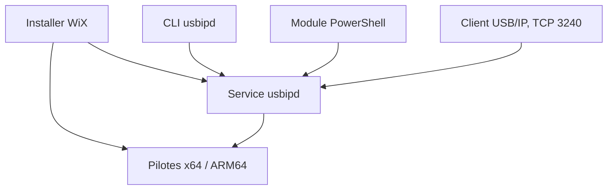

# dorssel/usbipd-win

> Service Windows qui partage des périphériques USB locaux avec des machines distantes, dont WSL 2 et Hyper-V.

## Le problème
Un périphérique USB branché sur Windows n'est pas visible dans WSL 2 ou une machine virtuelle sans manipulation.

## Ce que ça fait vraiment
Installe le service `usbipd`, un outil en ligne de commande et une règle de pare-feu (port TCP 3240). On liste les appareils, on les partage avec `bind` (persistant), puis on les attache à un client Linux avec `usbip attach` ou, pour WSL 2, `usbipd attach --wsl` (non persistant). Il s'appuie sur des pilotes noyau x64 et ARM64.

## Comment c'est branché


## Essayer
```powershell
winget install usbipd
usbipd list
usbipd bind --busid=<BUSID>
usbipd attach --wsl --busid=<BUSID>
```

## Coût et pièges
Gratuit. Windows 10 ou Server 2019 version 1809 ou plus récent ; droits administrateur pour partager. La règle de pare-feu ouvre le service à tous les sous-réseaux locaux. Le rattachement est à refaire après redémarrage.

## Ce que ce n'est pas
Ce n'est pas un client USB/IP pour Windows : seul le côté serveur est fourni. Tous les périphériques ne sont pas pris en charge par le noyau WSL 2 par défaut.

## Alternatives
Aucune alternative nommée dans le README.

## Pour toi
À surveiller : pratique pour utiliser une clé, une carte ou un appareil USB dans WSL 2 sous Windows.

