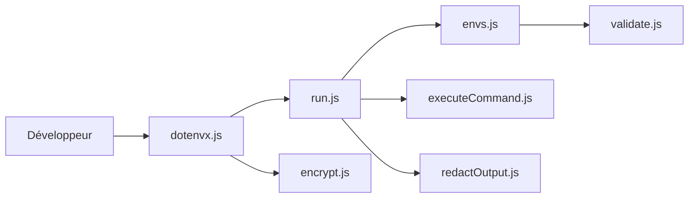

# dotenvx/dotenvx

> Loader for encrypted, multi-environment .env files, usable with any language.

## The problem
Plaintext `.env` files lie around in repositories, and each language has its own incompatible loader.

## What it actually does
`dotenvx run -- command` injects the variables into the process, whatever the language. `encrypt` encrypts the `.env` (secp256k1 public/private keys); the private key goes into `.env.keys`, the OS keychain or 1Password. It handles several files, Next.js/flow conventions, validation through `Envfile`, `--redact` to mask secrets in the output of agents (Claude, Codex, Cursor), `precommit` and `prebuild`. Armor is a hosted option.

## How it is wired


## Trying it
```bash
npm install @dotenvx/dotenvx --save
dotenvx encrypt
dotenvx run -- node index.js
dotenvx run --redact -- claude -p 'Print the value of $SECRET'
```

## Cost and gotchas
Free; Armor (key custody) is a third-party service requiring an account. On Linux, the keychain requires `secret-tool` and a D-Bus session. Keep a copy of the private key: losing it makes the secrets unreadable.

## What it is not
Not an enterprise secrets vault. Deno is not supported directly with the npm module. `--redact` only masks exact values.

## Alternatives
dotenv: the original project by the same author, without encryption.

## For you
Adopt: encrypt pipeline `.env` files and mask secrets in agent outputs, with a single tool for all languages.
