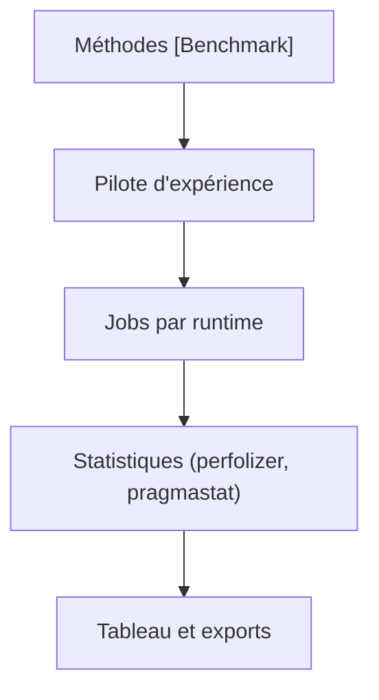

# dotnet/BenchmarkDotNet

> A .NET library that turns methods into reproducible benchmarks, for .NET developers.

## The problem
Hand-written micro-benchmarks give wrong numbers: warm-up ignored, code eliminated, noise unmeasured.

## What it actually does
You mark methods with `[Benchmark]`; the library determines the number of iterations, does the warm-up, computes the statistics and flags bad conditions (Debug mode, debugger, hypervisor). It compares several runtimes and exports to md, html, csv, json, with memory measurement and disassembly.

## How it is wired
Simplified diagram based on the sheet, no diagram provided.

## Trying it
No command documented: the README provides an example C# class with `[SimpleJob]` and `[Benchmark]`.

## Cost and gotchas
Free. .NET is required (not covered by the prerequisites list) and code compiled in Release. Graph exports use `[RPlotExporter]`.

## What it is not
Not a tool that makes benchmarks correct for you: designing the experiment remains your job.

## Alternatives
No alternative named in the README.

## For you
Ignore: without .NET code to measure, it brings nothing to a data/AI/MLOps profile.
