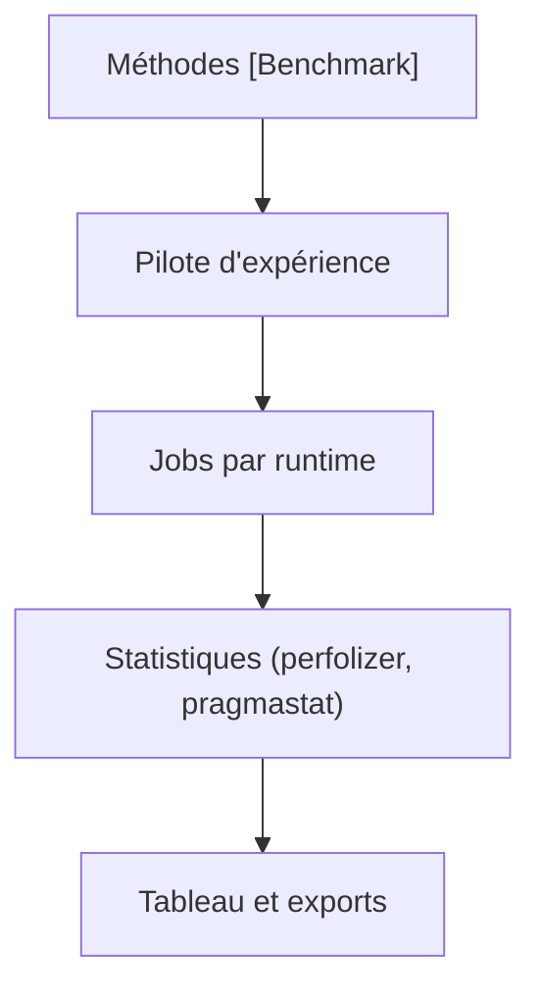

# dotnet/BenchmarkDotNet

> Bibliothèque .NET qui transforme des méthodes en benchmarks reproductibles, pour développeurs .NET.

## Le problème
Les micro-benchmarks écrits à la main donnent des chiffres faux : échauffement ignoré, code éliminé, bruit non mesuré.

## Ce que ça fait vraiment
On marque des méthodes avec `[Benchmark]` ; la bibliothèque détermine le nombre d'itérations, fait l'échauffement, calcule les statistiques et signale les mauvaises conditions (mode Debug, débogueur, hyperviseur). Elle compare plusieurs runtimes et exporte en md, html, csv, json, avec mesure mémoire et désassemblage.

## Comment c'est branché
Schéma simplifié d'après la fiche, sans diagramme fourni.

## Essayer
Aucune commande documentée : le README fournit un exemple de classe C# avec `[SimpleJob]` et `[Benchmark]`.

## Coût et pièges
Gratuit. Il faut .NET (non couvert par la liste de prérequis) et un code compilé en Release. Les exports en graphes utilisent `[RPlotExporter]`.

## Ce que ce n'est pas
Pas un outil qui rend les benchmarks corrects à votre place : concevoir l'expérience reste à ta charge.

## Alternatives
Aucune alternative nommée dans le README.

## Pour toi
À ignorer : sans code .NET à mesurer, il n'apporte rien à un profil data/IA/MLOps.

