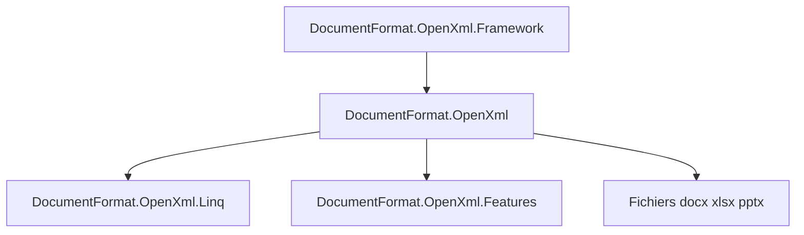

# dotnet/Open-XML-SDK

> .NET library for reading, creating and modifying Word, Excel and PowerPoint files, for C# developers.

## The problem
Generating or modifying Office documents on the server without installing Office means handling OPC packages and Open XML markup by hand.

## What it actually does
It provides strongly typed classes and a LINQ to XML API to manipulate OPC packages and the markup of Word, Excel and PowerPoint. Cited use cases: document generation, modification, regex search-and-replace, splitting and merging files, updating chart data. It does not provide a higher-level layer.

## How it is wired
Simplified diagram based on the fiche, no diagram provided.



## Trying it
The README gives no installation command. It points to the NuGet packages DocumentFormat.OpenXml and to a daily builds feed to declare in NuGet.config:
```xml
<add key="OpenXmlCI" value="https://ooxml.blob.core.windows.net/feed/index.json" />
```

## Cost and gotchas
Free. You need to know the formats and the ISO 29500 standard. Under .NET Core, ZIP packages cannot be read as a stream, so memory can blow up on large files.

## What it is not
Not a productivity tool: the README says so, it provides no high-level abstraction. The 3.0 versions bring breaking changes.

## Alternatives
- ClosedXml: simplified object model for Excel.
- OfficeIMO: simplified model for Word, Excel, PowerPoint with Markdown, HTML and PDF.
- ShapeCrawler: simplified model for PowerPoint.

## For you
Worth watching: useful only if you produce Office reports from C#; otherwise python-docx and the like are enough in your ecosystem.
