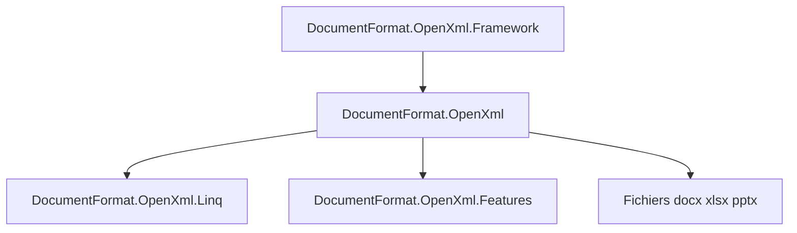

# dotnet/Open-XML-SDK

> Bibliothèque .NET pour lire, créer et modifier des fichiers Word, Excel et PowerPoint, pour développeurs C#.

## Le problème
Générer ou modifier des documents Office côté serveur sans installer Office demande de manipuler les paquets OPC et le XML Open XML à la main.

## Ce que ça fait vraiment
Elle donne des classes fortement typées et une API LINQ to XML pour manipuler les paquets OPC et le balisage de Word, Excel et PowerPoint. Cas cités : génération de documents, modification, recherche-remplacement par regex, découpage et fusion de fichiers, mise à jour des données de graphiques. Elle ne fournit pas de couche de plus haut niveau.

## Comment c'est branché
Schéma simplifié d'après la fiche, sans diagramme fourni.



## Essayer
Le README ne donne pas de commande d'installation. Il renvoie aux paquets NuGet DocumentFormat.OpenXml et à un flux de builds quotidiens à déclarer dans NuGet.config :
```xml
<add key="OpenXmlCI" value="https://ooxml.blob.core.windows.net/feed/index.json" />
```

## Coût et pièges
Gratuit. Il faut connaître les formats et la norme ISO 29500. Sous .NET Core, les paquets ZIP ne se lisent pas en flux, donc la mémoire peut exploser sur de gros fichiers.

## Ce que ce n'est pas
Pas un outil de productivité : le README le dit, elle ne fournit pas d'abstraction de haut niveau. Les versions 3.0 apportent des changements incompatibles.

## Alternatives
- ClosedXml : modèle objet simplifié pour Excel.
- OfficeIMO : modèle simplifié pour Word, Excel, PowerPoint avec Markdown, HTML et PDF.
- ShapeCrawler : modèle simplifié pour PowerPoint.

## Pour toi
À surveiller : utile seulement si tu produis des rapports Office depuis du C#, sinon python-docx et consorts suffisent dans ton écosystème.

