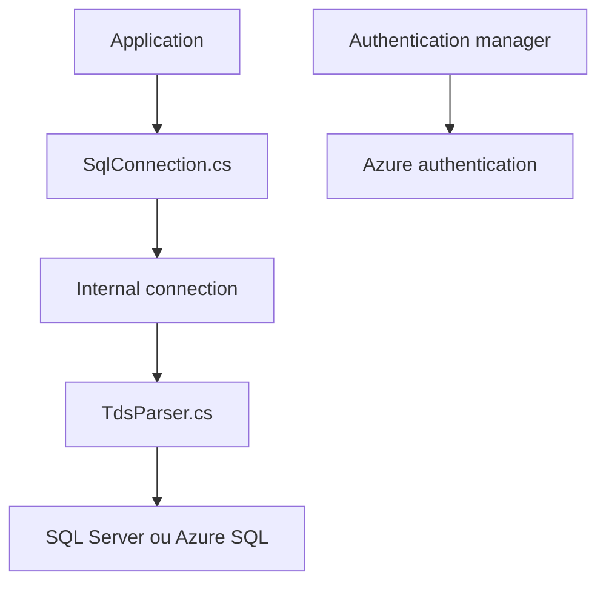

# dotnet/SqlClient

> The official .NET data provider for SQL Server and Azure SQL, successor to System.Data.SqlClient.

## The problem
A .NET application needs a maintained driver to talk to SQL Server, with the new Azure SQL features.

## What it actually does
Provides connection, commands, data reader, bulk copy and transactions against SQL Server. The code contains a TDS parser, a connection pool, authentication providers (including Azure) and an Azure Key Vault provider for Always Encrypted. Distributed as a NuGet package.

## How it is wired

## Trying it
No command documented in the README: the `Microsoft.Data.SqlClient` package is installed from NuGet.org, and build guides are in BUILDGUIDE.md.

## Cost and gotchas
Free, but only useful with SQL Server or Azure SQL. On Windows, native SNI libraries are loaded through a separate package.

## What it is not
It is not an ORM, nor a driver for other databases. It is not the old System.Data.SqlClient: a porting guide exists.

## Alternatives
System.Data.SqlClient, the older component this one derives from.

## For you
Ignore unless your data pipeline is in .NET on SQL Server: it is the reference driver, of no interest outside that ecosystem.
