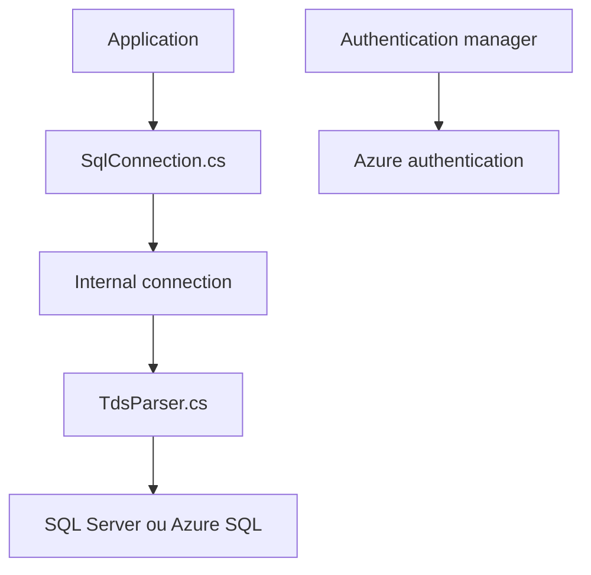

# dotnet/SqlClient

> Fournisseur de données .NET officiel pour SQL Server et Azure SQL, successeur de System.Data.SqlClient.

## Le problème
Une application .NET a besoin d'un pilote maintenu pour parler à SQL Server, avec les nouvelles fonctions Azure SQL.

## Ce que ça fait vraiment
Fournit connexion, commandes, lecteur de données, copie en masse et transactions vers SQL Server. Le code contient un analyseur TDS, un pool de connexions, des fournisseurs d'authentification (dont Azure) et un fournisseur Azure Key Vault pour Always Encrypted. Distribué en paquet NuGet.

## Comment c'est branché

## Essayer
Aucune commande documentée dans le README : le paquet `Microsoft.Data.SqlClient` s'installe depuis NuGet.org, et les guides de build sont dans BUILDGUIDE.md.

## Coût et pièges
Gratuit, mais utile seulement avec SQL Server ou Azure SQL. Sous Windows, des bibliothèques natives SNI sont chargées par paquet séparé.

## Ce que ce n'est pas
Ce n'est pas un ORM, ni un pilote pour d'autres bases. Ce n'est pas l'ancien System.Data.SqlClient : une fiche de portage existe.

## Alternatives
System.Data.SqlClient, l'ancien composant dont celui-ci est issu.

## Pour toi
À ignorer sauf si ton pipeline data est en .NET sur SQL Server : c'est le pilote de référence, sans intérêt hors de cet écosystème.

