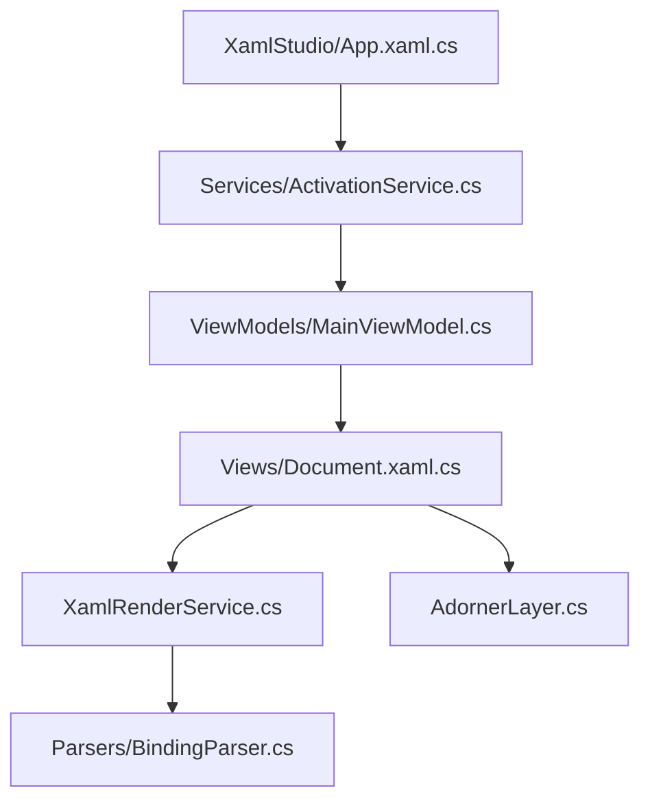

# dotnet/XAMLStudio

> Windows application for live prototyping of WinUI XAML, with a binding debugger.

## The problem
Testing a XAML interface requires building and launching the full application from Visual Studio.

## What it actually does
Live editing and rendering, binding debugger, data context editor, IntelliSense, namespace helpers. v2 (`dev` branch) adds a properties panel, visual tree, folders. The code: `ActivationService` opens the window, `Document` hands the XAML to `XamlRenderService`, which analyzes bindings and autocompletion.

## How it is wired


## Trying it
```bash
git clone https://github.com/dotnet/XAMLStudio.git
git checkout dev
# Ouvrir XAMLStudio.slnx avec Visual Studio, projet XAMLStudio en démarrage, F5
```

## Cost and gotchas
Visual Studio 2022+, UWP tools, Windows SDK 17763, Windows 10+. Telemetry can be disabled; no key is used in builds from source. Known issue on ARM64.

## What it is not
The `main` branch corresponds to Store v1.1; v2 lives in `dev`. Not a cross-platform tool.

## Alternatives
No alternative named in the README.

## For you
Ignore: a Windows interface development tool, unrelated to data or AI.
