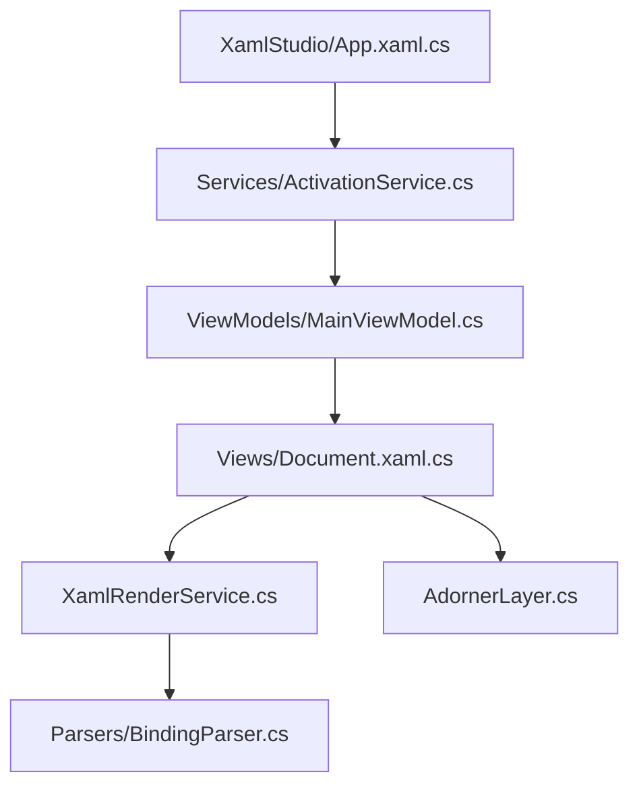

# dotnet/XAMLStudio

> Application Windows pour prototyper du XAML WinUI en direct, avec débogueur de liaisons.

## Le problème
Tester une interface XAML oblige à compiler et lancer l'application complète depuis Visual Studio.

## Ce que ça fait vraiment
Édition et rendu en direct, débogueur de bindings, éditeur de contexte de données, IntelliSense, aides aux espaces de noms. La v2 (branche `dev`) ajoute panneau de propriétés, arbre visuel, dossiers. Le code : `ActivationService` ouvre la fenêtre, `Document` confie le XAML à `XamlRenderService`, qui analyse les bindings et l'autocomplétion.

## Comment c'est branché


## Essayer
```bash
git clone https://github.com/dotnet/XAMLStudio.git
git checkout dev
# Ouvrir XAMLStudio.slnx avec Visual Studio, projet XAMLStudio en démarrage, F5
```

## Coût et pièges
Visual Studio 2022+, outils UWP, SDK Windows 17763, Windows 10+. La télémétrie est désactivable ; aucune clé n'est utilisée dans les builds depuis les sources. Problème connu sur ARM64.

## Ce que ce n'est pas
La branche `main` correspond à la v1.1 du Store ; la v2 vit dans `dev`. Pas un outil multiplateforme.

## Alternatives
Aucune alternative nommée dans le README.

## Pour toi
Ignorer : outil de développement d'interfaces Windows, sans rapport avec la data ou l'IA.

