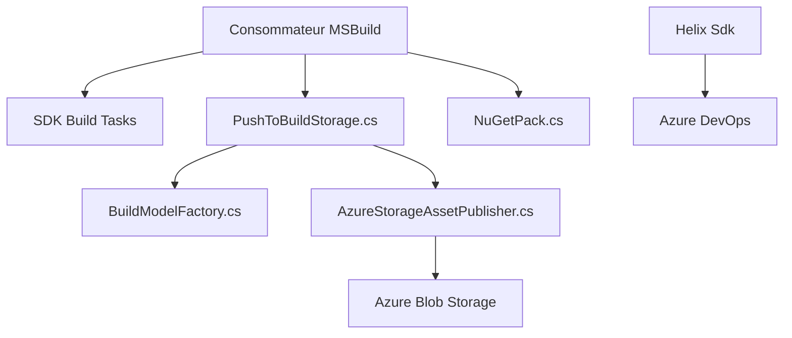

# dotnet/arcade

> Shared build infrastructure of the .NET team: packaging, artifact publishing, testing and signing.

## The problem
Dozens of .NET repositories must build, package, sign and publish in the same way, without copy-pasting build scripts.

## What it actually does
Provides MSBuild tasks for the build SDK, NuGet packaging and installers. Models artifact manifests and pushes them to Azure Blob Storage. Drives Helix tests and their results in Azure DevOps. Also contains API comparison and signature verification.

## How it is wired

## Trying it
No installation command in the README: it points to the documentation and to the package feed `https://pkgs.dev.azure.com/dnceng/public/_packaging/dotnet-eng/nuget/v3/index.json`.

## Cost and gotchas
Free, but designed for Microsoft's .NET and Azure DevOps ecosystem. Outside that ecosystem, the value is low.

## What it is not
Not a mainstream library nor an AI tool. Not a product documented for outsiders: it is internal plumbing made open.

## Alternatives
No alternative cited in the README.

## For you
Ignore: it is internal .NET build infrastructure, unrelated to everyday data, AI or MLOps work.
