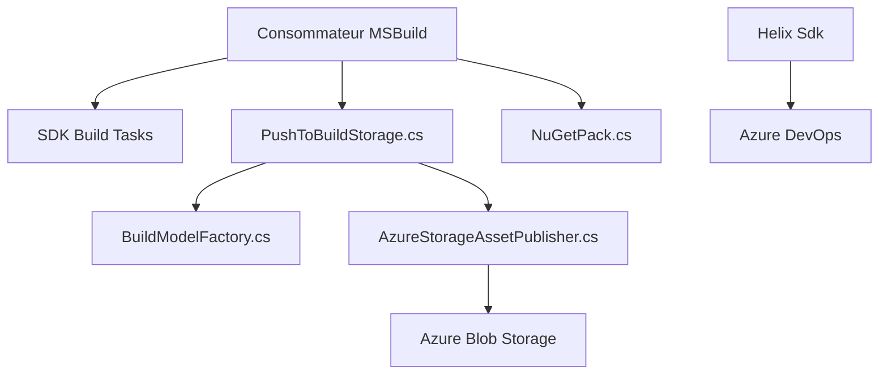

# dotnet/arcade

> Infrastructure de build partagée de l'équipe .NET : packaging, publication d'artefacts, tests et signature.

## Le problème
Des dizaines de dépôts .NET doivent compiler, empaqueter, signer et publier de la même façon, sans copier-coller des scripts de build.

## Ce que ça fait vraiment
Fournit des tâches MSBuild pour le SDK de build, le packaging NuGet et les installeurs. Modélise les manifestes d'artefacts et les pousse vers Azure Blob Storage. Pilote les tests Helix et leurs résultats dans Azure DevOps. Contient aussi la comparaison d'API et la vérification de signatures.

## Comment c'est branché

## Essayer
Aucune commande d'installation dans le README : il renvoie à la documentation et au flux de paquets `https://pkgs.dev.azure.com/dnceng/public/_packaging/dotnet-eng/nuget/v3/index.json`.

## Coût et pièges
Gratuit, mais pensé pour l'écosystème .NET et Azure DevOps de Microsoft. Hors de cet écosystème, la valeur est faible.

## Ce que ce n'est pas
Pas une bibliothèque grand public ni un outil d'IA. Pas un produit documenté pour l'extérieur : c'est de la plomberie interne ouverte.

## Alternatives
Aucune alternative citée dans le README.

## Pour toi
À ignorer : c'est de l'infrastructure de build .NET interne, sans lien avec un travail data, IA ou MLOps courant.

