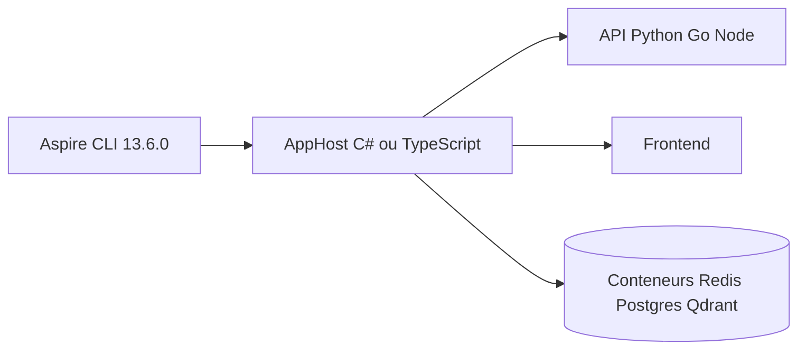

# dotnet/aspire-samples

> Official Aspire samples for orchestrating front end, API, containers and databases locally.

## The problem
Wiring up a front end, an API, databases and containers by hand to test a distributed app is repetitive.

## What it actually does
Repository of samples organized by scenario: JavaScript, polyglot, per-language integrations (Go, Python), interactive terminals, cloud and AI. Each sample states its AppHost (C# or TypeScript) and its deployment (Run only, Docker Compose, Azure). Among them are a "RAG Document Q&A" (Svelte, FastAPI, Qdrant, OpenAI) and a "Python OpenAI Agent".

## How it is wired
Simplified diagram based on the sheet, no diagram provided.


## Trying it
```bash
curl -fsSL https://aspire.dev/install.sh | bash -s -- --version 13.6.0
```

## Cost and gotchas
Free. Some samples require Azure or an OpenAI key. The README warns that the code illustrates concepts and must not be used as a basis for commercial or production use.

## What it is not
It is not a framework: these are demonstrations. No sample is guaranteed to follow production best practices.

## Alternatives
No alternative named in the README.

## For you
Worth watching: the RAG sample and the OpenAI agent show how to orchestrate an AI service with its dependencies locally; otherwise the rest is mostly .NET.
