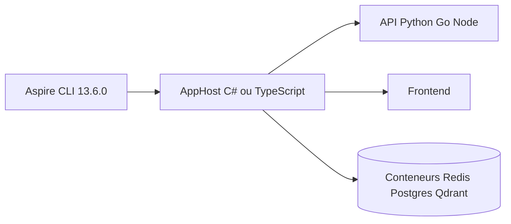

# dotnet/aspire-samples

> Exemples officiels d'Aspire pour orchestrer front, API, conteneurs et bases en local.

## Le problème
Brancher à la main un front, une API, des bases et des conteneurs pour tester une appli distribuée est répétitif.

## Ce que ça fait vraiment
Dépôt d'exemples rangés par scénario : JavaScript, polyglotte, intégrations par langage (Go, Python), terminaux interactifs, cloud et IA. Chaque exemple précise son AppHost (C# ou TypeScript) et son déploiement (Run only, Docker Compose, Azure). On y trouve notamment un « RAG Document Q&A » (Svelte, FastAPI, Qdrant, OpenAI) et un « Python OpenAI Agent ».

## Comment c'est branché
Schéma simplifié d'après la fiche, sans diagramme fourni.


## Essayer
```bash
curl -fsSL https://aspire.dev/install.sh | bash -s -- --version 13.6.0
```

## Coût et pièges
Gratuit. Certains exemples exigent Azure ou une clé OpenAI. Le README signale que le code illustre des concepts et ne doit pas servir de base commerciale ou de production.

## Ce que ce n'est pas
Ce n'est pas un framework : ce sont des démonstrations. Aucun exemple n'est garanti sur les bonnes pratiques de production.

## Alternatives
Aucune alternative nommée dans le README.

## Pour toi
À surveiller : l'exemple RAG et l'agent OpenAI montrent comment orchestrer un service d'IA avec ses dépendances en local, sans quoi le reste est surtout .NET.

