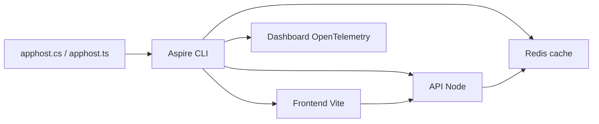

# dotnet/aspire

> Microsoft toolkit to describe in code, run locally and deploy multi-language distributed applications.

## The problem
Wiring services, frontends, databases, caches and telemetry by hand makes the local environment fragile and hard to reproduce through to deployment.

## What it actually does
- An application definition ("AppHost") in C# or TypeScript declares services, containers, databases and references between them.
- The Aspire CLI runs everything locally and exposes OpenTelemetry-based observability (dashboard).
- The same definition is used for deployment.
- The repository contains the CLI, AppHost SDK, dashboard, service discovery, templates, integrations, VS Code extension.

## How it is wired


## Trying it
```bash
curl -sSL https://aspire.dev/install.sh | bash
```

## Cost and gotchas
Free; installation goes through a remote script (curl | bash). The third-party containers used remain for you to evaluate (README warning).

## What it is not
Not a production orchestrator on its own: it describes and runs, deployment depends on the targets. The README does not detail the deployment targets. 2,727 open issues.

## Alternatives
No alternative named in the README.

## For you
Keep an eye on it: useful if you build multi-service stacks with OTel observability locally, but very centered on the Microsoft/.NET ecosystem and little tied to data/AI.
