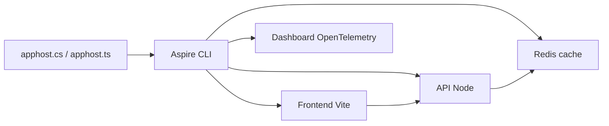

# dotnet/aspire

> Boîte à outils Microsoft pour décrire en code, lancer en local et déployer des applications distribuées multi-langages.

## Le problème
Brancher à la main services, frontends, bases, caches et télémétrie rend l'environnement local fragile et difficile à reproduire jusqu'au déploiement.

## Ce que ça fait vraiment
- Une définition d'application (« AppHost ») en C# ou TypeScript déclare services, conteneurs, bases et références entre eux.
- La CLI Aspire lance l'ensemble en local et expose une observabilité basée sur OpenTelemetry (tableau de bord).
- La même définition sert au déploiement.
- Le dépôt contient CLI, SDK AppHost, dashboard, service discovery, templates, intégrations, extension VS Code.

## Comment c'est branché


## Essayer
```bash
curl -sSL https://aspire.dev/install.sh | bash
```

## Coût et pièges
Gratuit ; l'installation passe par un script distant (curl | bash). Les conteneurs tiers utilisés restent à évaluer par toi (avertissement du README).

## Ce que ce n'est pas
Pas un orchestrateur de production à lui seul : il décrit et lance, le déploiement dépend des cibles. Le README ne détaille pas les cibles de déploiement. 2 727 issues ouvertes.

## Alternatives
Aucune alternative nommée dans le README.

## Pour toi
Surveiller : utile si tu montes des stacks multi-services avec observabilité OTel en local, mais très centré sur l'écosystème Microsoft/.NET et peu lié à la data/IA.

