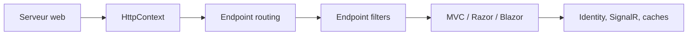

# dotnet/aspnetcore

> Framework web multiplateforme de Microsoft pour applications cloud et API sur .NET.

## Le problème
Construire des applications web et des API performantes et portables sur .NET.

## Ce que ça fait vraiment
Un serveur web produit un contexte HTTP, routé vers un endpoint, éventuellement filtré, et le résultat est renvoyé. Le dépôt contient aussi MVC et Razor, composants Blazor, Identity, antiforgery, protection des données, SignalR, caches SQL Server et Redis, health checks, localisation, OpenAPI.

## Comment c'est branché

## Essayer
Le README renvoie aux instructions « Getting Started » et à des builds nocturnes ; aucune commande n'y figure. Le SDK .NET suffit selon le texte (« installe le SDK »).

## Coût et pièges
Gratuit. Les bogues de sécurité se signalent en privé au MSRC. Les builds nocturnes sont instables par nature.

## Ce que ce n'est pas
Pas un framework d'IA ni de data. Pas le runtime .NET (dépôt voisin « Runtime »).

## Alternatives
Aucune alternative nommée dans le README.

## Pour toi
Ignorer : écosystème .NET sans rapport direct avec le travail data/IA, sauf pour exposer un modèle via API sur une pile Microsoft.

