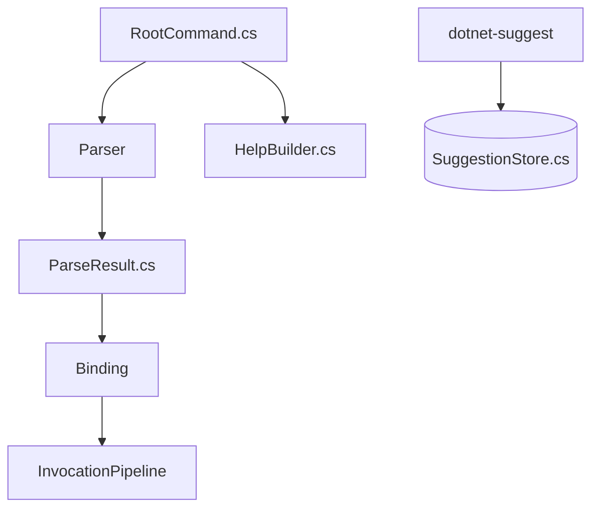

# dotnet/command-line-api

> System.CommandLine library and dotnet-suggest tool: command-line parsing and completion for .NET applications.

## The problem
Hand-writing argument parsing, help and shell completion for a .NET tool is repetitive and fragile.

## What it actually does
- Command model (RootCommand, Command, Option, Argument), parsing and type binding.
- Invocation pipeline separate from parsing, generated help, directives, localization.
- `dotnet-suggest`: global tool that registers and distributes shell completion.
- Tests, benchmarks and API compatibility checks.

## How it is wired

## Trying it
No command in the README; NuGet packages `System.CommandLine` and `dotnet-suggest`, documentation on Microsoft Learn.

## Cost and gotchas
Free. Real requirement: .NET SDK. Daily builds go through an Azure DevOps NuGet feed.

## What it is not
Not a full application framework: only the command line. 497 open issues.

## Alternatives
No alternative named in the README.

## For you
Ignore unless you write tools in C#; in Python you already have your own CLI libraries.
