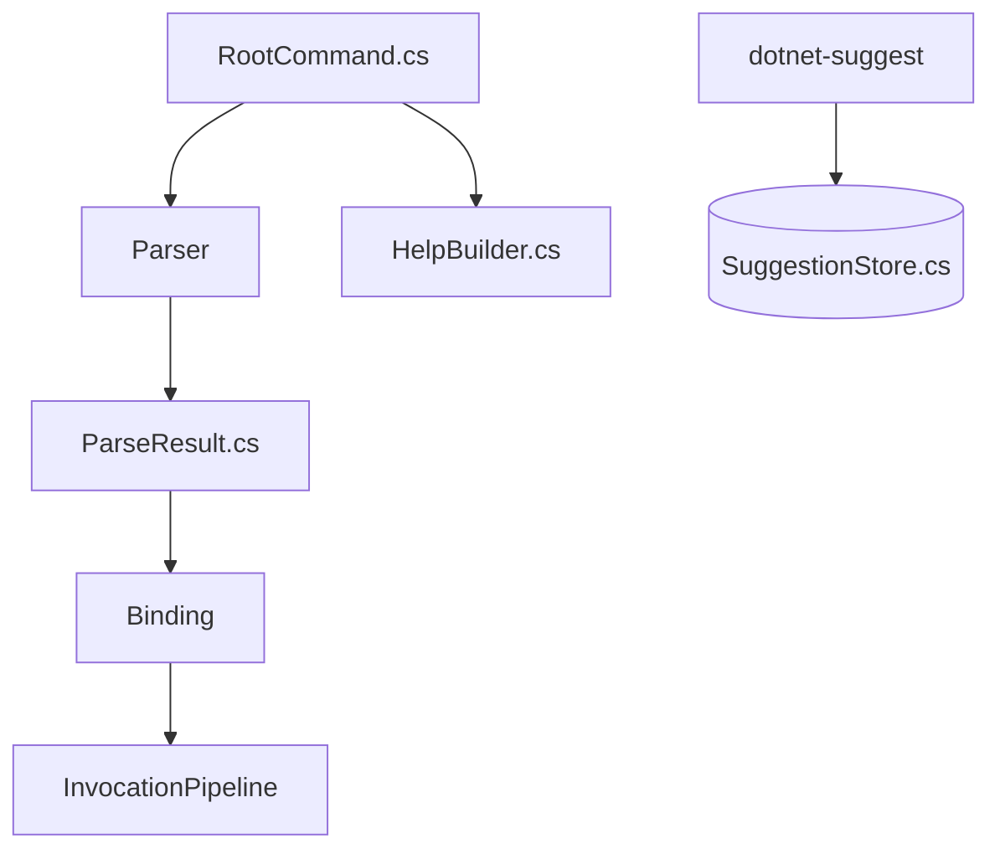

# dotnet/command-line-api

> Bibliothèque System.CommandLine et outil dotnet-suggest : analyse de ligne de commande et complétion pour applications .NET.

## Le problème
Écrire à la main l'analyse d'arguments, l'aide et la complétion shell d'un outil .NET est répétitif et fragile.

## Ce que ça fait vraiment
- Modèle de commandes (RootCommand, Command, Option, Argument), analyse et liaison de types.
- Pipeline d'invocation séparé de l'analyse, aide générée, directives, localisation.
- `dotnet-suggest` : outil global qui enregistre et distribue la complétion shell.
- Tests, benchmarks et vérification de compatibilité d'API.

## Comment c'est branché

## Essayer
Aucune commande dans le README ; paquets NuGet `System.CommandLine` et `dotnet-suggest`, documentation sur Microsoft Learn.

## Coût et pièges
Gratuit. Besoin réel : SDK .NET. Les builds quotidiens passent par un flux NuGet Azure DevOps.

## Ce que ce n'est pas
Pas un framework d'application complet : seulement la ligne de commande. 497 tickets ouverts.

## Alternatives
Aucune alternative nommée dans le README.

## Pour toi
À ignorer sauf si tu écris des outils en C# ; en Python tu as déjà tes propres bibliothèques CLI.

