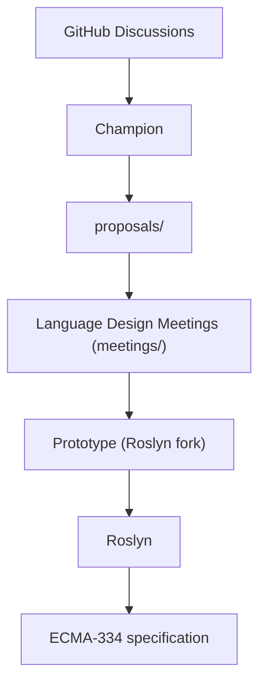

# dotnet/csharplang

> Official design repository of the C# language: proposals, meeting notes and version history.

## The problem
Knowing how and why C# evolves, and how to propose a feature.

## What it actually does
Hosts feature proposals (proposals folder), notes from the design meetings (meetings) and the version history. Debates go through GitHub Discussions; a proposal is only opened as an issue when a "champion" invites it. The reference implementation lives in Roslyn.

## How it is wired

## Trying it
No documented command: you read the proposals and meetings folders.

## Cost and gotchas
Free. No license recognized by the catalog. An active proposal is not guaranteed to succeed. 298 open issues.

## What it is not
It is neither the compiler nor the full language specification (that lives in another repository). It is not a help forum.

## Alternatives
No alternative named in the README (pointers to Roslyn and the specification repository).

## For you
Ignore, unless you follow the evolution of C#; unrelated to data/AI/MLOps.
