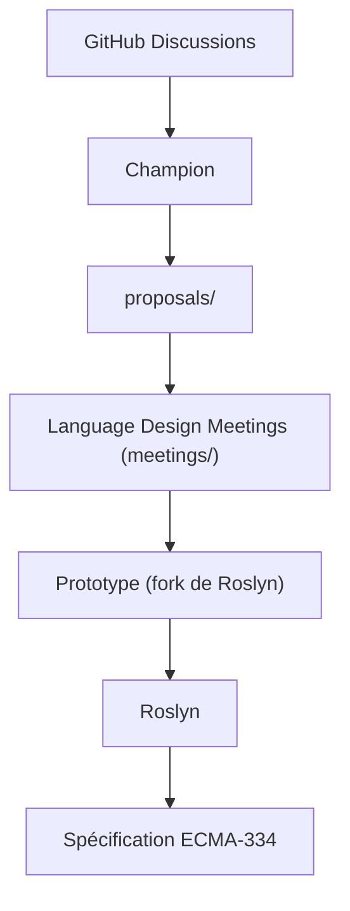

# dotnet/csharplang

> Dépôt officiel de conception du langage C# : propositions, notes de réunions et historique des versions.

## Le problème
Savoir comment et pourquoi C# évolue, et comment proposer une fonctionnalité.

## Ce que ça fait vraiment
Héberge les propositions de fonctionnalités (dossier proposals), les notes des réunions de conception (meetings) et l'historique des versions. Les débats passent par les Discussions GitHub ; une proposition n'est ouverte en issue que sur invitation d'un « champion ». L'implémentation de référence est dans Roslyn.

## Comment c'est branché

## Essayer
Aucune commande documentée : on lit les dossiers proposals et meetings.

## Coût et pièges
Gratuit. Aucune licence reconnue par le catalogue. Une proposition active n'est pas garantie d'aboutir. 298 issues ouvertes.

## Ce que ce n'est pas
Ce n'est pas le compilateur ni la spécification complète du langage (celle-ci est dans un autre dépôt). Ce n'est pas un forum d'entraide.

## Alternatives
Aucune alternative nommée dans le README (renvois vers Roslyn et le dépôt de spécification).

## Pour toi
À ignorer, sauf si tu suis l'évolution de C# ; sans lien avec data/IA/MLOps.

