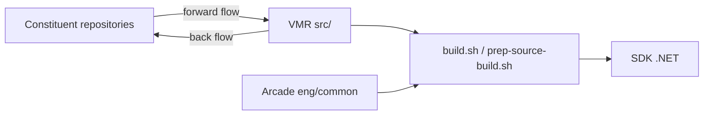

# dotnet/dotnet

> Virtual monolithic repository of the .NET source code, to build the entire SDK from a single commit.

## The problem
Building .NET requires assembling many repositories (runtime, sdk, aspnetcore…). Linux distributors and third parties want a single reproducible source point.

## What it actually does
Mirrors the product repositories under `src/` and synchronizes in both directions through "code flow" PRs (forward flow, back flow). Provides the scripts to build the SDK, including offline source-build. Day-to-day development work stays in the original repositories. E2E tests are announced as "coming soon".

## How it is wired


## Trying it
```bash
git clone https://github.com/dotnet/dotnet dotnet-dotnet
cd dotnet-dotnet
./build.sh --clean-while-building
./prep-source-build.sh
./build.sh -sb --clean-while-building
dotnet --info
```

## Cost and gotchas
Heavy build; Docker recommended if the environment is not ready, `brotli-dev` required for source-build, short paths and long paths enabled on Windows. The README states that the repository is a work in progress.

## What it is not
Not the place to contribute to the product code: changes go to the constituent repositories. Not an SDK to install (installers exist for that).

## Alternatives
- dotnet/source-build: cited for the source-build of the whole product.
- The constituent repositories (dotnet/runtime, dotnet/sdk) for contributing.

## For you
Ignore for a data/AI profile: unless you need to compile .NET yourself, you install the binary SDK.
