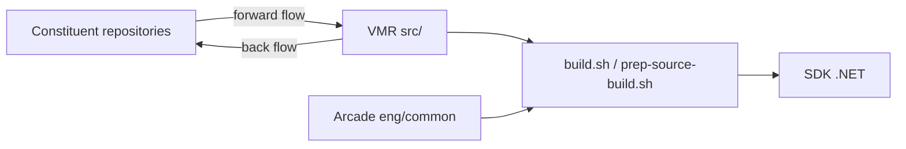

# dotnet/dotnet

> Dépôt monolithique virtuel du code source .NET, pour construire le SDK entier depuis un seul commit.

## Le problème
Construire .NET demande d'assembler de nombreux dépôts (runtime, sdk, aspnetcore…). Les distributeurs Linux et les tiers veulent un seul point source reproductible.

## Ce que ça fait vraiment
Reflète les dépôts produit sous `src/` et synchronise dans les deux sens par des PR de « code flow » (forward flow, back flow). Fournit les scripts pour construire le SDK, y compris en source-build hors ligne. Le travail de développement courant reste dans les dépôts d'origine. Les tests E2E sont annoncés « à venir ».

## Comment c'est branché


## Essayer
```bash
git clone https://github.com/dotnet/dotnet dotnet-dotnet
cd dotnet-dotnet
./build.sh --clean-while-building
./prep-source-build.sh
./build.sh -sb --clean-while-building
dotnet --info
```

## Coût et pièges
Build lourd ; Docker conseillé si l'environnement n'est pas prêt, `brotli-dev` requis pour source-build, chemins courts et long paths activés sous Windows. Le README précise que le dépôt est un travail en cours.

## Ce que ce n'est pas
Pas l'endroit où contribuer au code produit : les changements vont dans les dépôts constituants. Pas un SDK à installer (des installeurs existent pour cela).

## Alternatives
- dotnet/source-build : cité pour le source-build de tout le produit.
- Les dépôts constituants (dotnet/runtime, dotnet/sdk) pour contribuer.

## Pour toi
À ignorer pour un profil data/IA : sauf besoin de compiler .NET toi-même, tu installes le SDK binaire.

