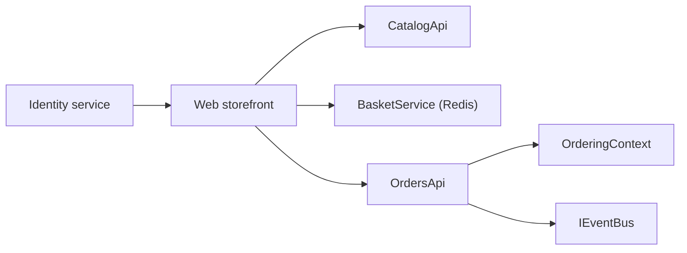

# dotnet/eShop

> .NET reference application: an e-commerce site built as services, orchestrated with Aspire.

## The problem
There is no concrete example of a service-based architecture in .NET with messaging, identity and a database.

## What it actually does
"AdventureWorks" shop: web and MAUI clients, Catalog, Basket (Redis), Identity, Ordering services (database, domain, buyer validation, payment, grace-period worker), an integration event bus, webhooks. An optional AI chatbot uses Microsoft Foundry (gpt-4.1-mini, text-embedding-3-small). Based on .NET 10.

## How it is wired


## Trying it
```console
aspire --version
git clone https://github.com/dotnet/eShop.git
cd eShop
aspire run
```

## Cost and gotchas
Free locally (.NET 10 SDK, Aspire CLI, Docker or Podman). The chatbot requires an Azure subscription; `aspire destroy` deletes the whole resource group.

## What it is not
Not production-ready: the Azure Container Apps deployment is designed for demos, with databases in containers.

## Alternatives
No alternative named, apart from the "eShop on Azure" repository for an Azure deployment.

## For you
Worth watching as a service architecture model with an AI chatbot example, if you work in .NET; otherwise of little use.
