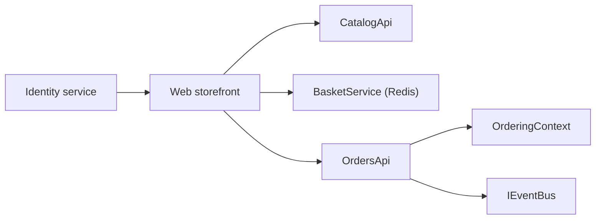

# dotnet/eShop

> Application de référence .NET : site e-commerce en services, orchestrée avec Aspire.

## Le problème
Il manque un exemple concret d'architecture en services en .NET avec messagerie, identité et base de données.

## Ce que ça fait vraiment
Boutique « AdventureWorks » : clients web et MAUI, services Catalogue, Panier (Redis), Identité, Commandes (base, domaine, validation acheteur, paiement, worker de période de grâce), bus d'événements d'intégration, webhooks. Un chatbot IA optionnel utilise Microsoft Foundry (gpt-4.1-mini, text-embedding-3-small). Basé sur .NET 10.

## Comment c'est branché


## Essayer
```console
aspire --version
git clone https://github.com/dotnet/eShop.git
cd eShop
aspire run
```

## Coût et pièges
Gratuit en local (SDK .NET 10, Aspire CLI, Docker ou Podman). Le chatbot exige un abonnement Azure ; `aspire destroy` supprime tout le groupe de ressources.

## Ce que ce n'est pas
Pas prêt pour la production : le déploiement Azure Container Apps est conçu pour des démos, les bases en conteneurs.

## Alternatives
Aucune alternative nommée, hors le dépôt « eShop on Azure » pour un déploiement Azure.

## Pour toi
À surveiller comme modèle d'architecture en services avec un exemple de chatbot IA, si tu travailles en .NET ; sinon peu utile.

