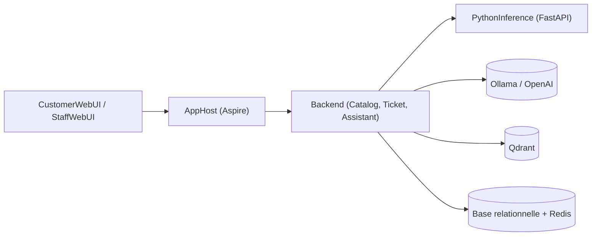

# dotnet/eShopSupport

> .NET Aspire demo application for customer support with generative AI: classification, summarization, chatbot.

## The problem
Show how to integrate generative text (classification, sentiment analysis, summarization, assistant) into a .NET application end to end.

## What it actually does
Based on the code: AppHost orchestrates APIs (Catalog, Tickets, Assistant, messaging), two Blazor interfaces (customer and staff), an identity provider and a Python inference service (embeddings, classification). The assistant calls OpenAI or a local model via Ollama; Qdrant handles vector search, Redis handles real-time messaging. An evaluator tests the answers. The sample data is fictional, generated by GPT-3.5.

## How it is wired


## Trying it
```bash
dotnet workload update
dotnet workload install aspire
dotnet restore eShopSupport.sln
pip install -r src/PythonInference/requirements.txt
dotnet run --project src/AppHost
```

## Cost and gotchas
The README asks for an Nvidia GPU (CPU workaround mentioned without detail), Docker Desktop, Python 3.12.5 and the .NET 8 SDK. The last push dates from May 2025.

## What it is not
Not a support product: it is a demo, whose cloud deployment is only planned. The repository has not moved in over a year.

## Alternatives
The README cites no alternative.

## For you
Worth watching: a good example of RAG/LLM architecture with evaluation in a .NET ecosystem, but frozen since May 2025 and heavy to launch.
