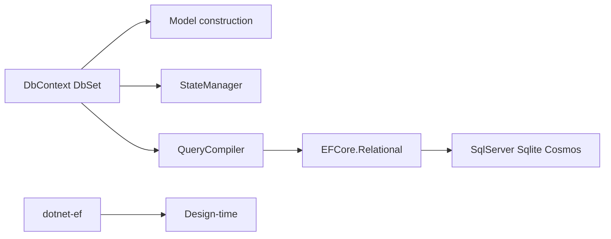

# dotnet/efcore

> Object-database mapper for .NET (Entity Framework Core) and an ADO.NET SQLite driver.

## The problem
Querying and updating a relational database from C# without writing SQL and mapping by hand.

## What it actually does
`DbContext` composes the model, change tracking, the LINQ query compiler and services. A common relational layer serves the SQL Server and SQLite providers; Cosmos follows its own pipeline, and an in-memory provider exists. Migrations and `dotnet-ef` tooling. Microsoft.Data.Sqlite is a standalone driver.

## How it is wired


## Trying it
```bash
dotnet add package Microsoft.EntityFrameworkCore.SqlServer
dotnet add package Microsoft.EntityFrameworkCore.Sqlite
dotnet add package Microsoft.Data.Sqlite
```

## Cost and gotchas
Free. Daily builds are recommended for new features, as official releases lag behind. With more than 2,000 open issues, triage is busy.

## What it is not
This repository is the source code, not a tutorial. .NET ecosystem only.

## Alternatives
No alternative named in the README.

## For you
Ignore if you work in Python; essential if you write C# with a relational database.
