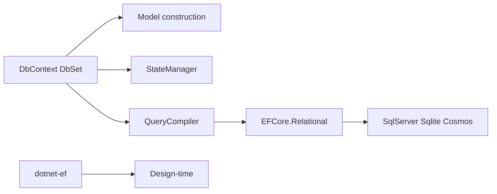

# dotnet/efcore

> Mappeur objet-base de données de .NET (Entity Framework Core) et pilote ADO.NET SQLite.

## Le problème
Interroger et mettre à jour une base relationnelle depuis C# sans écrire du SQL et du mapping à la main.

## Ce que ça fait vraiment
`DbContext` compose modèle, suivi des changements, compilateur de requêtes LINQ et services. Une couche relationnelle commune sert les fournisseurs SQL Server et SQLite ; Cosmos suit son propre pipeline, et un fournisseur en mémoire existe. Migrations et outils `dotnet-ef`. Microsoft.Data.Sqlite est un pilote autonome.

## Comment c'est branché


## Essayer
```bash
dotnet add package Microsoft.EntityFrameworkCore.SqlServer
dotnet add package Microsoft.EntityFrameworkCore.Sqlite
dotnet add package Microsoft.Data.Sqlite
```

## Coût et pièges
Gratuit. Les builds quotidiens sont recommandés pour les nouveautés, les versions officielles étant en retard. Sur plus de 2 000 issues ouvertes, le suivi est chargé.

## Ce que ce n'est pas
Ce dépôt est le code source, pas un tutoriel. Écosystème .NET uniquement.

## Alternatives
Aucune alternative nommée dans le README.

## Pour toi
Ignorer si tu travailles en Python ; incontournable si tu écris du C# avec base relationnelle.

