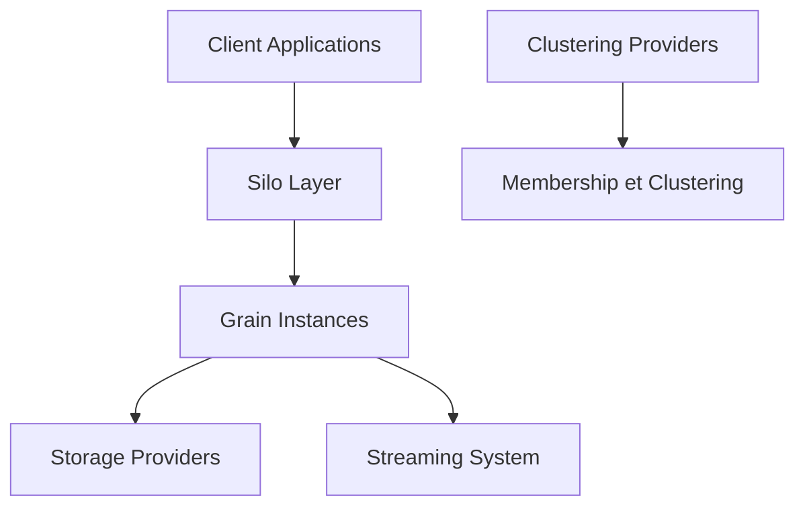

# dotnet/orleans

> .NET framework for distributed applications built on virtual actors, for cloud service developers.

## The problem
Writing stateful distributed services forces you to handle placement, failure recovery and concurrency by hand.

## What it actually does
The basic unit is the "grain": an entity with identity, behavior and state. A "silo" hosts grains and a group of silos forms a cluster. The runtime activates and places grains, and handles persistence, streams, timers, reminders, transactions and versioning.

## How it is wired


## Trying it
```bash
dotnet build Orleans.slnx -bl
```
The quick start is the "Hello World" in the official documentation.

## Cost and gotchas
Free, MIT license. You need .NET. Storage and streams often use cloud services (Azure, AWS) at your expense.

## What it is not
It is not a database nor a container orchestrator: it is an application programming model for .NET.

## Alternatives
No alternative named in the README.

## For you
Ignore: C# distributed services framework, with no direct link to data, AI or MLOps in Python.
