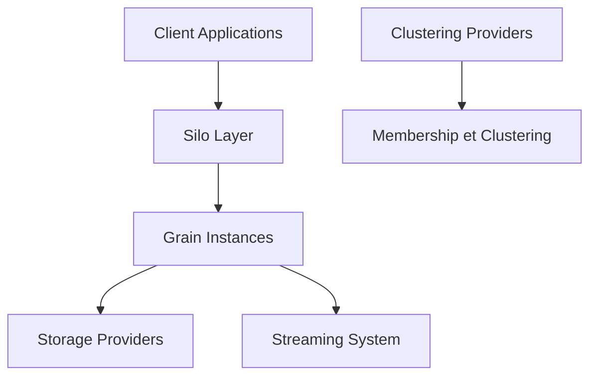

# dotnet/orleans

> Cadre .NET d'applications distribuées par acteurs virtuels, pour développeurs de services cloud.

## Le problème
Écrire des services distribués avec état oblige à gérer le placement, la reprise sur panne et la concurrence à la main.

## Ce que ça fait vraiment
L'unité de base est le « grain » : une entité avec identité, comportement et état. Un « silo » héberge les grains et un groupe de silos forme un cluster. Le runtime active et place les grains, gère persistance, flux, minuteurs, rappels, transactions et versions.

## Comment c'est branché


## Essayer
```bash
dotnet build Orleans.slnx -bl
```
Le démarrage rapide est le « Hello World » de la documentation officielle.

## Coût et pièges
Gratuit, licence MIT. Il faut .NET. Les stockages et flux utilisent souvent des services cloud (Azure, AWS) qui sont à ta charge.

## Ce que ce n'est pas
Ce n'est pas une base de données ni un orchestrateur de conteneurs : c'est un modèle de programmation applicatif pour .NET.

## Alternatives
Aucune alternative nommée dans le README.

## Pour toi
Ignorer : cadre de services distribués en C#, sans lien direct avec la data, l'IA ou le MLOps en Python.

