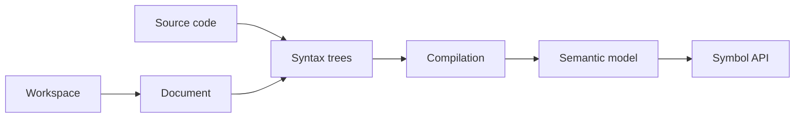

# dotnet/roslyn

> Open-source C# and Visual Basic compilers, with APIs for building code analysis tools.

## The problem
Analyzing or transforming .NET code requires structured access to syntax trees and semantics.

## What it actually does
Implements the C# and VB compilers and exposes APIs: syntax trees, compilation, semantic model, symbols; workspace model (solution, project, document), analyzers, fixes, IDE services, language server, C# scripting host. Very thin README, mostly build badges.

## How it is wired

## Trying it
No command in the README: prerelease NuGet packages on listed Azure DevOps feeds, and an architecture overview online.

## Cost and gotchas
Free, but a large project (6,700 open issues). Language feature requests go to csharplang/vblang.

## What it is not
Not an IDE; nor is it a data/AI tool.

## Alternatives
None named in the README.

## For you
Ignore: serves C#/.NET developers writing analyzers, nothing for a data / AI profile.
