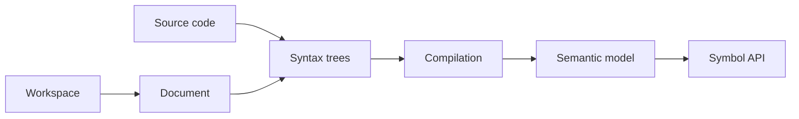

# dotnet/roslyn

> Compilateurs C# et Visual Basic open source, avec API pour bâtir des outils d'analyse de code.

## Le problème
Analyser ou transformer du code .NET demande un accès structuré aux arbres syntaxiques et à la sémantique.

## Ce que ça fait vraiment
Implémente les compilateurs C# et VB et expose des API : arbres syntaxiques, compilation, modèle sémantique, symboles ; modèle de workspace (solution, projet, document), analyseurs, correctifs, services IDE, serveur de langage, hôte de scripting C#. README très mince, surtout des badges de build.

## Comment c'est branché

## Essayer
Aucune commande dans le README : paquets NuGet de préversion sur des flux Azure DevOps listés, et vue d'ensemble de l'architecture en ligne.

## Coût et pièges
Gratuit, mais gros projet (6 700 issues ouvertes). Les demandes de fonctions du langage vont à csharplang/vblang.

## Ce que ce n'est pas
Pas un IDE ; ce n'est pas non plus un outil pour data/IA.

## Alternatives
Aucune nommée dans le README.

## Pour toi
Ignorer : sert aux développeurs C#/.NET qui écrivent des analyseurs, rien pour un profil data / IA.

