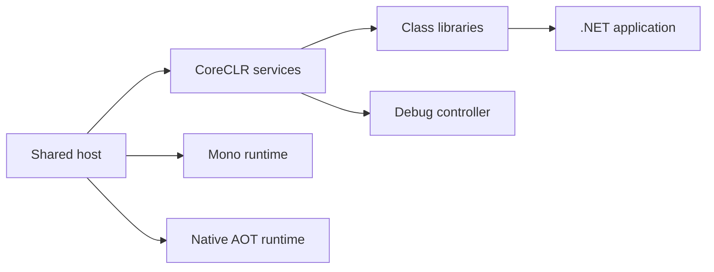

# dotnet/runtime

> Source code of the .NET runtime, its class libraries and the shared `dotnet` host.

## The problem
This repository is the common base on which all .NET applications run.

## What it actually does
Contains the runtimes (CoreCLR, Mono, Native AOT), the shared host, the standard libraries, debugging and diagnostics (EventPipe, dump creation) and WebAssembly hosting (JS engine, WASI). The README is mostly an index of links (contributing, security, resources). A .NET Foundation project; vulnerabilities are to be reported to MSRC.

## How it is wired

## Trying it
The README contains no command: it points to the build documentation and nightly builds.

## Cost and gotchas
Free (MIT). A huge repository (8,151 open issues): you consult it, you do not clone it lightly.

## What it is not
Not the SDK nor the development tools: only the runtime and libraries.

## Alternatives
No alternative named in the README.

## For you
No direct use in data/AI, unless you work in C#; ignore as a watch source.
