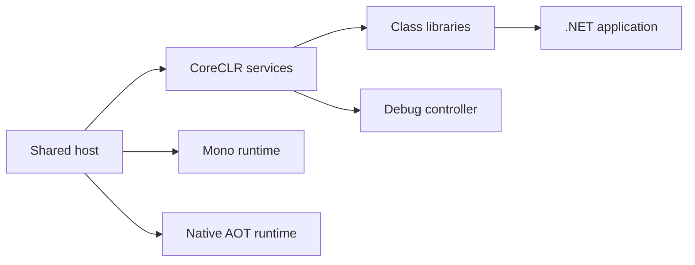

# dotnet/runtime

> Code source du runtime .NET, de ses bibliothèques de classes et de l'hôte partagé `dotnet`.

## Le problème
Ce dépôt est la base commune sur laquelle tournent toutes les applications .NET.

## Ce que ça fait vraiment
Contient les runtimes (CoreCLR, Mono, Native AOT), l'hôte partagé, les bibliothèques standard, le débogage et les diagnostics (EventPipe, création de dumps) et l'hébergement WebAssembly (moteur JS, WASI). Le README est surtout un index de liens (contribution, sécurité, ressources). Projet de la .NET Foundation ; failles à signaler au MSRC.

## Comment c'est branché

## Essayer
Le README ne contient aucune commande : il renvoie à la documentation de build et aux builds nocturnes.

## Coût et pièges
Gratuit (MIT). Dépôt énorme (8 151 issues ouvertes) : on le consulte, on ne le clone pas à la légère.

## Ce que ce n'est pas
Pas le SDK ni les outils de développement : seulement runtime et bibliothèques.

## Alternatives
Aucune alternative nommée dans le README.

## Pour toi
Sans usage direct en data/IA, sauf si tu travailles en C# ; à ignorer comme source de veille.

