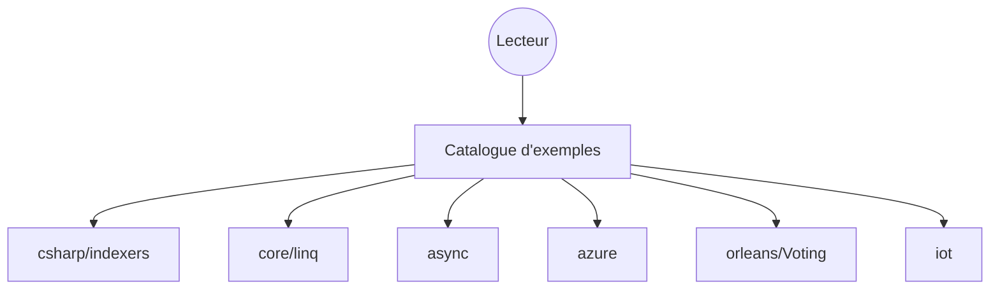

# dotnet/samples

> Catalog of code samples that accompany the .NET documentation, for C# developers who learn by example.

## The problem
The .NET docs articles need compilable examples, gathered in one place.

## What it actually does
- Independent sample folders, mirroring the structure of the docs.
- Topics: C# language, LINQ, async, JSON, Azure, Orleans, IoT, WCF.
- Each sample is a compilable project with its own `readme.md`.
- Issues are disabled: they are opened in dotnet/docs.

## How it is wired


## Trying it
```bash
dotnet build
dotnet run
```

## Cost and gotchas
Free. You need the .NET SDK; some samples require Windows, Visual Studio or the .NET Framework.

## What it is not
Not an application or a library: a collection with no shared runtime. The README announces CI as "coming soon".

## Alternatives
No alternative named in the README.

## For you
Ignore unless you are learning .NET: no data / AI sample is highlighted.
