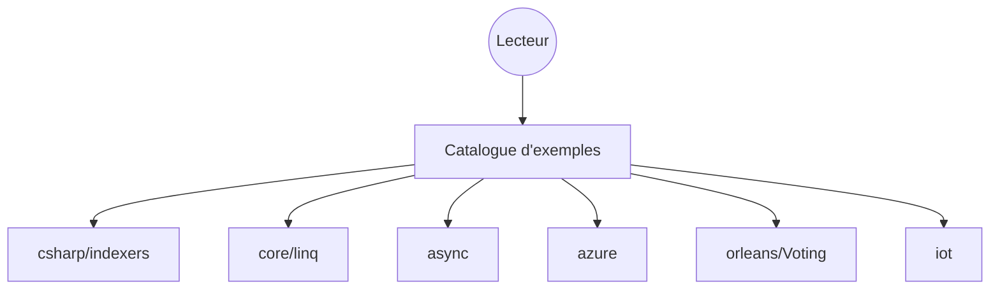

# dotnet/samples

> Catalogue d'exemples de code qui accompagnent la documentation .NET, pour développeurs C# apprenant par l'exemple.

## Le problème
Les articles de la doc .NET ont besoin d'exemples compilables, regroupés au même endroit.

## Ce que ça fait vraiment
- Dossiers d'exemples indépendants, calqués sur le plan de la doc.
- Thèmes : langage C#, LINQ, async, JSON, Azure, Orleans, IoT, WCF.
- Chaque exemple est un projet compilable avec son propre `readme.md`.
- Les tickets sont désactivés : on les ouvre dans dotnet/docs.

## Comment c'est branché


## Essayer
```bash
dotnet build
dotnet run
```

## Coût et pièges
Gratuit. Il faut le SDK .NET ; certains exemples exigent Windows, Visual Studio ou le .NET Framework.

## Ce que ce n'est pas
Pas une application ni une bibliothèque : un recueil sans runtime commun. Le CI est annoncé « bientôt » dans le README.

## Alternatives
Aucune alternative nommée dans le README.

## Pour toi
À ignorer sauf si tu apprends .NET : aucun exemple data / IA n'est mis en avant.

