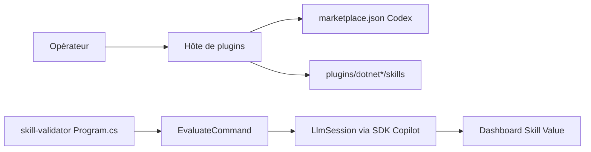

# dotnet/skills

> Official catalog of .NET skills and agents for Copilot CLI, Claude Code, Cursor and Codex.

## The problem
Coding agents know current .NET practices poorly: MSBuild, EF, testing, upgrades, Blazor, MAUI. Each team rewrites its own instructions.

## What it actually does
Publishes a plugin marketplace: each plugin bundles portable skills (agentskills.io standard) or Copilot agents. Sixteen plugins: MSBuild build, NuGet, data/EF, diagnostics, testing, upgrade, MAUI, AI/ML, ASP.NET Core, Blazor, WinForms, .NET 11. A `skill-validator` tool evaluates whether a skill really improves the agent.

## How it is wired


## Trying it
```bash
/plugin marketplace add dotnet/skills
/plugin install <plugin>@dotnet-agent-skills
codex plugin marketplace add dotnet/skills
```

## Cost and gotchas
Free; the host agent consumes its own quota. The `agents/*.agent.md` files follow Copilot conventions and do not install as native Codex agents.

## What it is not
Not a .NET library nor an agent framework: only instructions for agents. The exact content of each skill is not described in the README.

## Alternatives
- anthropics/skills: generic skills collection, cited in another repo of the batch, not in this README.

## For you
Ignore unless you write .NET: a Python data/AI/MLOps profile gets nothing from it, apart from the `dotnet-ai` plugin for those doing ML.NET.
