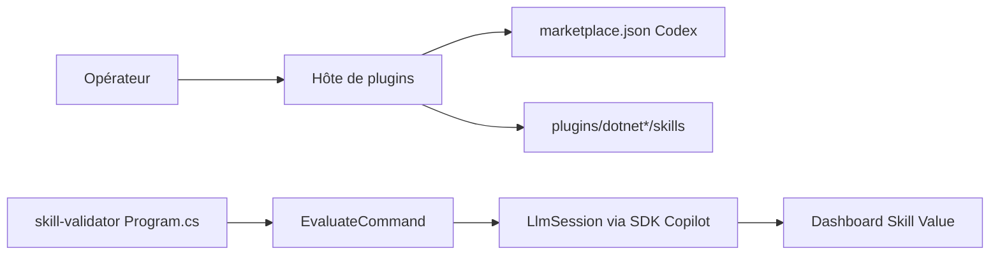

# dotnet/skills

> Catalogue officiel de skills et d'agents .NET pour Copilot CLI, Claude Code, Cursor et Codex.

## Le problème
Les agents de code connaissent mal les pratiques .NET actuelles : MSBuild, EF, tests, upgrades, Blazor, MAUI. Chaque équipe réécrit ses propres consignes.

## Ce que ça fait vraiment
Publie une place de marché de plugins : chaque plugin regroupe des skills portables (norme agentskills.io) ou des agents Copilot. Seize plugins : build MSBuild, NuGet, data/EF, diagnostics, tests, upgrade, MAUI, AI/ML, ASP.NET Core, Blazor, WinForms, .NET 11. Un outillage `skill-validator` évalue si un skill améliore vraiment l'agent.

## Comment c'est branché


## Essayer
```bash
/plugin marketplace add dotnet/skills
/plugin install <plugin>@dotnet-agent-skills
codex plugin marketplace add dotnet/skills
```

## Coût et pièges
Gratuit ; l'agent hôte consomme son propre quota. Les fichiers `agents/*.agent.md` suivent les conventions Copilot et ne s'installent pas comme agents Codex natifs.

## Ce que ce n'est pas
Pas une bibliothèque .NET ni un framework d'agents : uniquement des consignes pour agents. Le contenu exact de chaque skill n'est pas décrit dans le README.

## Alternatives
- anthropics/skills : collection générique de skills, citée dans un autre dépôt du lot, non dans ce README.

## Pour toi
À ignorer sauf si tu écris du .NET : un profil data/IA/MLOps en Python n'en tire rien, hormis le plugin `dotnet-ai` pour qui fait du ML.NET.

