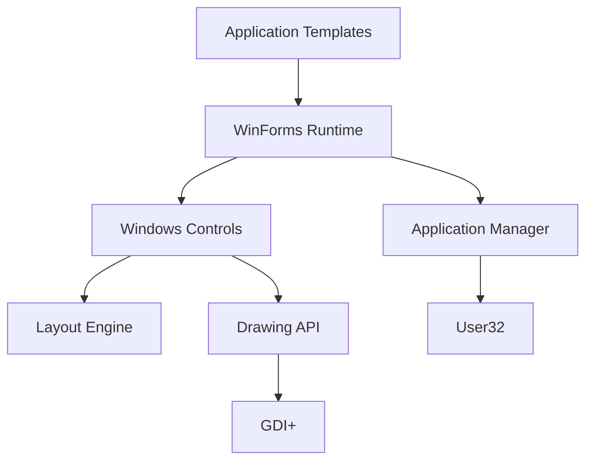

# dotnet/winforms

> .NET framework for building Windows desktop applications, with a visual designer.

## The problem
Quickly building Windows business desktop applications with rich screens and little UI code.

## What it actually does
Implementation of Windows Forms for .NET: a layer over User32 and GDI+ providing controls, layout, drawing, printing and accessibility. It is a fork of the .NET Framework 4.8 code. The repository contains neither the .NET Framework variant nor the Visual Studio designer. Project templates and design services (drag-and-drop, undo) are included.

## How it is wired

## Trying it
No command documented in the README: see the guides `docs/getting-started.md` and `docs/developer-guide.md`.

## Cost and gotchas
Free, but Windows only. The designer depends on Visual Studio, outside this repository. Many open issues (961).

## What it is not
Not a cross-platform or modern framework: the README rules out what WPF or WinUI already do. Nor is it the WinForms of .NET Framework.

## Alternatives
The README cites WPF and WinUI for modern interfaces.

## For you
Ignore: a Windows desktop UI tool, unrelated to data or AI.
