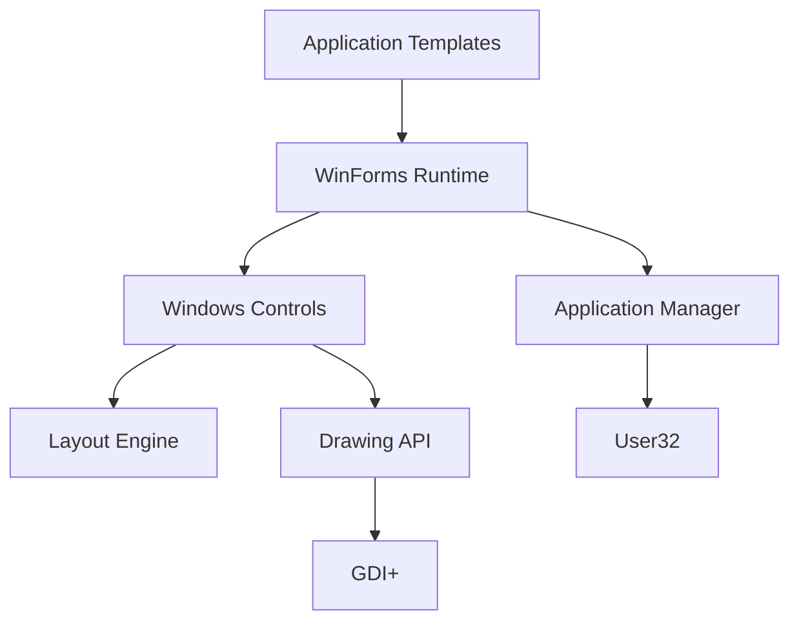

# dotnet/winforms

> Framework .NET pour construire des applications de bureau Windows, avec concepteur visuel.

## Le problème
Créer rapidement des applications de bureau Windows de gestion avec des écrans riches et peu de code d'interface.

## Ce que ça fait vraiment
Implémentation de Windows Forms pour .NET : une couche sur User32 et GDI+ qui fournit contrôles, mise en page, dessin, impression et accessibilité. C'est un fork du code .NET Framework 4.8. Le dépôt ne contient ni la variante .NET Framework ni le concepteur Visual Studio. Les modèles de projet et les services de conception (glisser-déposer, annulation) y figurent.

## Comment c'est branché

## Essayer
Aucune commande documentée dans le README : voir les guides `docs/getting-started.md` et `docs/developer-guide.md`.

## Coût et pièges
Gratuit, mais réservé à Windows. Le concepteur dépend de Visual Studio, hors de ce dépôt. Beaucoup d'issues ouvertes (961).

## Ce que ce n'est pas
Pas un framework multiplateforme ni moderne : le README écarte ce que WPF ou WinUI font déjà. Ce n'est pas non plus le WinForms de .NET Framework.

## Alternatives
Le README cite WPF et WinUI pour les interfaces modernes.

## Pour toi
Ignorer : un outil d'interfaces de bureau Windows, sans rapport avec la data ou l'IA.

