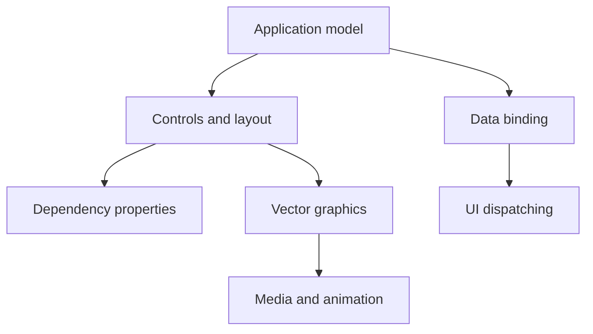

# dotnet/wpf

> Windows desktop UI framework in XAML, for .NET developers.

## The problem
Building rich, vector-based, data-bound Windows desktop applications requires a declarative UI framework.

## What it actually does
WPF provides an application model, resources, controls, layout, data binding, vector graphics and documents, described in XAML. WindowsBase provides properties and the dispatcher, PresentationCore and WpfGfx handle rendering. It supports ARM64 since .NET 6.

## How it is wired

## Trying it
No command documented in the README: it points to the getting-started instructions and the .NET SDK.

## Cost and gotchas
Free. Visual Studio 2022 Preview required to build the repo; Windows only. 1,702 open issues.

## What it is not
It is not cross-platform: WPF and WinForms only run on Windows. .NET Framework issues are not filed here.

## Alternatives
No alternative named in the README, apart from WinForms.

## For you
Ignore: Windows UI framework, unrelated to data / AI / MLOps work on Linux.
