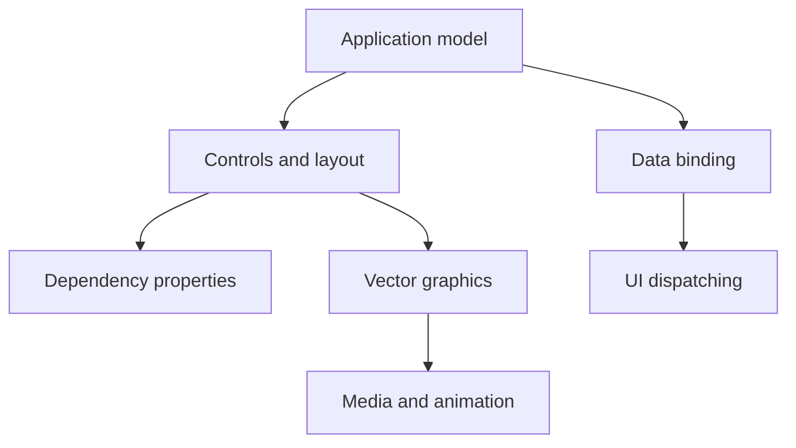

# dotnet/wpf

> Framework d'interfaces de bureau Windows en XAML, pour développeurs .NET.

## Le problème
Construire des applications de bureau Windows riches, vectorielles et liées aux données demande un cadre d'interface déclaratif.

## Ce que ça fait vraiment
WPF fournit modèle d'application, ressources, contrôles, mise en page, liaison de données, graphique vectoriel et documents, décrits en XAML. WindowsBase apporte propriétés et dispatcher, PresentationCore et WpfGfx le rendu. Il prend en charge ARM64 depuis .NET 6.

## Comment c'est branché

## Essayer
Aucune commande documentée dans le README : il renvoie aux instructions de démarrage et au SDK .NET.

## Coût et pièges
Gratuit. Visual Studio 2022 Preview requis pour compiler le dépôt ; Windows uniquement. 1 702 issues ouvertes.

## Ce que ce n'est pas
Ce n'est pas multiplateforme : WPF et WinForms ne tournent que sous Windows. Les problèmes de .NET Framework ne se déposent pas ici.

## Alternatives
Aucune alternative nommée dans le README, hors WinForms.

## Pour toi
À ignorer : cadre d'interface Windows, sans rapport avec un travail data / IA / MLOps sous Linux.

