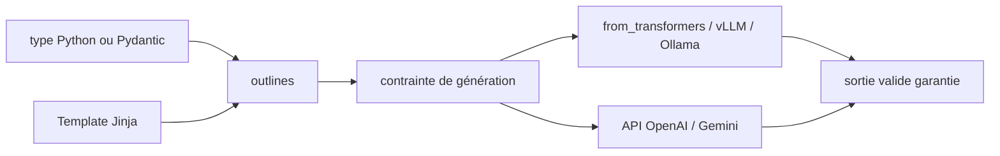

# dottxt-ai/outlines

> Enforces the structure of an LLM output during generation, not after.

## The problem
Repairing an LLM output after the fact — parsing, regex, retries — breaks as soon as the model changes format.

## What it actually does
You pass the desired type as the second argument: `model(prompt, output_type)`. A `Literal["Yes","No"]` for a choice, `int` for a number, a Pydantic model for an object, a function signature for function calling, a regex or a grammar for the rest. The same code runs on transformers, llama.cpp, vLLM, Ollama, OpenAI, Gemini and Dottxt. `outlines.Template.from_string` and `from_file` separate prompts from code, with Jinja syntax. Union types let the model answer with a structure or `"I don't know"`.

## How it is wired


## Trying it
```bash
pip install outlines
```

## Cost and gotchas
Free on the library side. The examples load local models (`microsoft/Phi-3-mini-4k-instruct`, `microsoft/phi-4`) with `device_map="auto"`: a GPU is strongly advised. On API backends, the constraint can only apply to what the provider exposes. Outputs are JSON strings to pass back through `model_validate_json`.

## What it is not
It is not a semantic guardrail: the structure is guaranteed, not the correctness of the content. It is not an agent framework. The company .txt sells enterprise libraries in parallel and offers a schema audit — the open source repository is not the whole offering.

## Alternatives
- No alternative repository named in the README.

## For you
The building block to put under any LLM extraction or classification pipeline. The "Efficient Guided Generation" paper is cited for the method.
