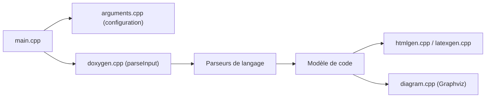

# doxygen/doxygen

> A documentation generator from annotated sources, mainly C++, for teams who document their code.

## The problem
Keeping API documentation consistent with the code requires extracting it from the sources rather than rewriting it.

## What it actually does
It reads annotated sources (C++, C, C#, Java, Python, PHP, Fortran, VHDL and others) and generates HTML, LaTeX, PDF, RTF, DocBook and man pages. It can also extract the structure of undocumented code and produce inclusion, inheritance and collaboration diagrams, with Graphviz, PlantUML or MSC as options.

## How it is wired

## Trying it
The README contains no command: it points to https://www.doxygen.nl/ for binaries and to the installation manual.

## Cost and gotchas
Free. GPL-2.0 license. Full diagrams only with Graphviz installed. 1,903 open issues.

## What it is not
Not a documentation tool for notebooks or ML pipelines. Not a tutorial generator: it documents APIs.

## Alternatives
No alternative named in the README.

## For you
Watch: relevant if you document a C or C++ computation library; for pure Python, other tools fit better.
