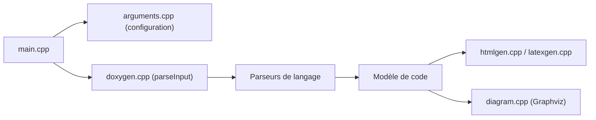

# doxygen/doxygen

> Un générateur de documentation à partir de sources annotées, surtout C++, pour les équipes qui documentent leur code.

## Le problème
Garder la documentation d'API cohérente avec le code demande de l'extraire des sources plutôt que de la réécrire.

## Ce que ça fait vraiment
Il lit des sources annotées (C++, C, C#, Java, Python, PHP, Fortran, VHDL et autres) et génère HTML, LaTeX, PDF, RTF, DocBook et pages man. Il peut aussi extraire la structure de code non documenté et produire des diagrammes d'inclusion, d'héritage et de collaboration, avec Graphviz, PlantUML ou MSC en option.

## Comment c'est branché

## Essayer
Le README ne contient pas de commande : il renvoie à https://www.doxygen.nl/ pour les binaires et au manuel d'installation.

## Coût et pièges
Gratuit. Licence GPL-2.0. Diagrammes complets seulement avec Graphviz installé. 1 903 issues ouvertes.

## Ce que ce n'est pas
Pas un outil de documentation pour notebooks ou pipelines ML. Pas un générateur de tutoriels : il documente des API.

## Alternatives
Aucune alternative nommée dans le README.

## Pour toi
À surveiller : pertinent si tu documentes une bibliothèque C ou C++ de calcul ; en Python pur, d'autres outils conviennent mieux.

