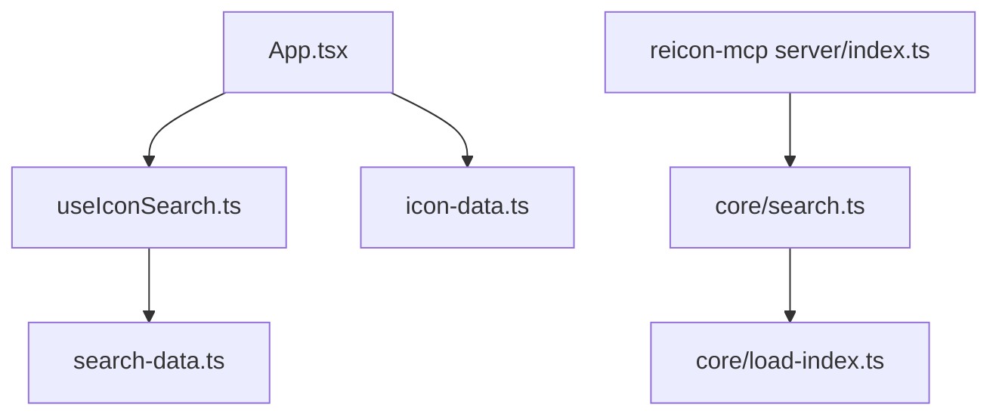

# dqev/reicon

> Library of over 2,700 SVG icons for React, Vue, Angular, Flutter and others, for designers and developers.

## The problem
Each front-end framework has its own icon sets, with inconsistent styles.

## What it actually does
An icon search site with preview, copy and raster export, plus per-framework packages (React, Vue, Svelte, Astro, Angular, React Native, Flutter, Compose), a Figma plugin, a VS Code extension and an MCP server to search icons from an assistant.

## How it is wired

## Trying it
No command is documented in the README: the packages are `reicon`, `reicon-react`, `reicon-vue`, `reicon-mcp`, etc.

## Cost and gotchas
Free. Some base icons come from Solar Icons (CC BY 4.0): attribution required. Project created in May 2026.

## What it is not
It is not a data visualization tool.

## Alternatives
No alternative named in the README.

## For you
Ignore: for interface icons, useful only if you are building a demo front end.
