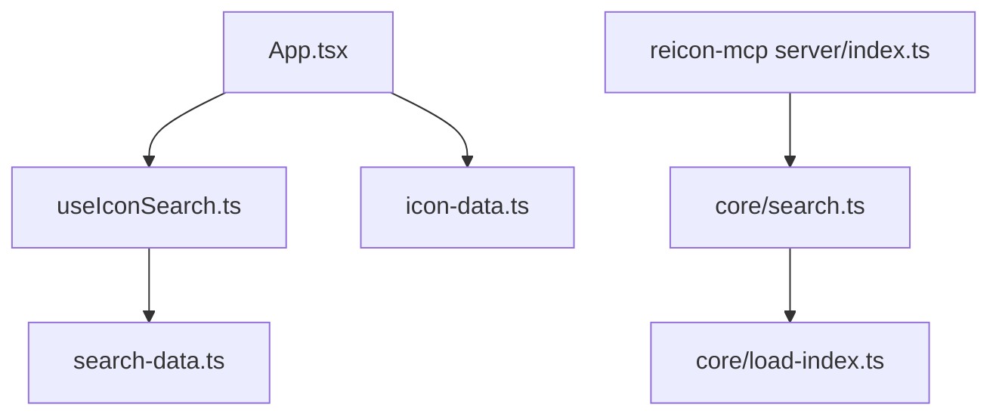

# dqev/reicon

> Bibliothèque de plus de 2 700 icônes SVG pour React, Vue, Angular, Flutter et autres, pour designers et développeurs.

## Le problème
Chaque framework front a ses propres jeux d'icônes, avec des styles incohérents.

## Ce que ça fait vraiment
Un site de recherche d'icônes avec aperçu, copie et export raster, plus des paquets par framework (React, Vue, Svelte, Astro, Angular, React Native, Flutter, Compose), un plugin Figma, une extension VS Code et un serveur MCP pour chercher des icônes depuis un assistant.

## Comment c'est branché

## Essayer
Aucune commande n'est documentée dans le README : les paquets sont `reicon`, `reicon-react`, `reicon-vue`, `reicon-mcp`, etc.

## Coût et pièges
Gratuit. Certaines icônes de base viennent de Solar Icons (CC BY 4.0) : attribution à prévoir. Projet créé en mai 2026.

## Ce que ce n'est pas
Ce n'est pas un outil de visualisation de données.

## Alternatives
Aucune alternative nommée dans le README.

## Pour toi
À ignorer : pour des icônes d'interface, utile seulement si tu construis un front de démonstration.

