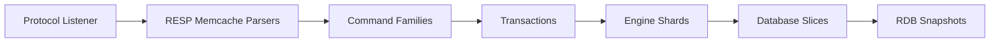

# dragonflydb/dragonfly

> Multi-threaded in-memory data store compatible with Redis and Memcached, for teams short on throughput.

## The problem
Redis processes each command on a single thread: throughput plateaus on large machines, which then have to be multiplied into several instances.

## What it actually does
"Shared-nothing" architecture: the keyspace is split into shards each handled by one thread, with atomic transactions inspired by VLL. Hash table based on Dash, fork-free snapshots, a "novel" eviction with zero memory overhead. About 185 Redis commands (equivalent to the Redis 5.0 API) and 13 Memcached commands. HTTP console and Prometheus metrics on the main port. Benchmarks are supplied by the vendor: 25× the throughput of a single-process Redis, 3.8 M QPS.

## How it is wired


## Trying it
```bash
./dragonfly-x86_64 --logtostderr --requirepass=youshallnotpass --cache_mode=true -dbnum 1 --bind localhost --port 6379 --maxmemory=12gb --keys_output_limit=12288 --dbfilename dump
```

## Cost and gotchas
Free when self-hosted; Dragonfly Cloud is paid. The license is not identified by GitHub and does not appear in the README: to be checked. The HTTP console on port 6379 should be disabled if the port is exposed.

## What it is not
Not a complete copy of Redis: the covered API corresponds to Redis 5.0, and long expiry deadlines are rounded to the second.

## Alternatives
No alternative is cited in the README (compared to Redis and Memcached).

## For you
Watch: a cache or feature queue faster than a single Redis, to be validated on your workload; check the license before any commercial use.
