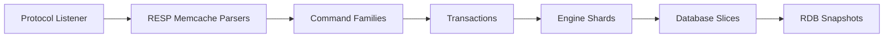

# dragonflydb/dragonfly

> Magasin de données en mémoire compatible Redis et Memcached, multi-thread, pour équipes qui manquent de débit.

## Le problème
Redis traite chaque commande sur un seul thread : le débit plafonne sur de grosses machines, qu'il faut alors multiplier en instances.

## Ce que ça fait vraiment
Architecture « shared-nothing » : le keyspace est découpé en shards gérés chacun par un thread, avec des transactions atomiques inspirées de VLL. Table de hachage basée sur Dash, snapshots sans fork, éviction « novatrice » à surcoût mémoire nul. Environ 185 commandes Redis (équivalent API Redis 5.0) et 13 commandes Memcached. Console HTTP et métriques Prometheus sur le port principal. Les benchmarks sont fournis par l'éditeur : 25× le débit d'un Redis mono-processus, 3,8 M QPS.

## Comment c'est branché


## Essayer
```bash
./dragonfly-x86_64 --logtostderr --requirepass=youshallnotpass --cache_mode=true -dbnum 1 --bind localhost --port 6379 --maxmemory=12gb --keys_output_limit=12288 --dbfilename dump
```

## Coût et pièges
Gratuit en auto-hébergement ; Dragonfly Cloud est payant. La licence n'est pas identifiée par GitHub et ne figure pas dans le README : à vérifier. La console HTTP sur le port 6379 est à désactiver si le port est exposé.

## Ce que ce n'est pas
Pas une copie complète de Redis : l'API couverte correspond à Redis 5.0, et les échéances d'expiration longues sont arrondies à la seconde.

## Alternatives
Aucune alternative citée dans le README (comparé à Redis et Memcached).

## Pour toi
À surveiller : un cache ou une file de features plus rapide qu'un Redis seul, à valider sur ta charge ; vérifie la licence avant tout usage commercial.

