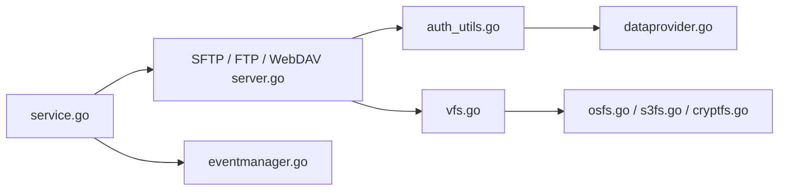

# drakkan/sftpgo

> Event-driven file transfer server (SFTP, FTP/S, WebDAV, HTTP/S) with local or cloud storage.

## The problem
Exchanging files with partners over standard protocols, storing them locally or on S3, GCS, Azure.

## What it is not
Not a simple SFTP server: a system of accounts, policies, public shares, MFA and automations. Advanced features (smart archiving, IMAP, PGP, antivirus/DLP, editing) are reserved for the Enterprise edition.

## What it actually does
SFTP, FTP/S, HTTP/S, WebDAV servers; WebAdmin and WebClient interfaces; REST API; event manager; virtual file system to local, encrypted, S3, GCS, Azure or another SFTP.

## How it is wired

## Trying it
The README gives no installation command: it refers to docs.sftpgo.com (Community edition).

## Cost and gotchas
Community is AGPL-3.0 and free; Enterprise is under a commercial license. New features arrive faster on the Enterprise side.

## Alternatives
No alternative named in the README.

## For you
Worth watching: a good building block for dropping data into an S3 bucket, but the AGPL and the two-edition model mean you must check that you don't need the paid features.
